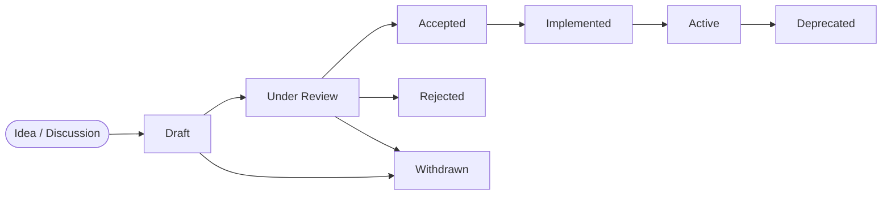

# CEP-0001: The Crystal Enhancement Proposal Process & Lifecycle Specification

- **Author(s):** Oswaldo Dantas <oswaldodantas@proton.me>
- **AI Runtime / Co-Pilot (Optional):** Antigravity CLI / gemini-3.8-flash
- **Status:** Draft
- **Type:** Process Track
- **Created:** 2026-10-05
- **Target Version:** v0.4.0
- **Discussions-To:** `.ccrystals/crystal-enhancement-proposal-process-and-media-extension`

---

## 1. Abstract

This specification formalizes the **Crystal Enhancement Proposal (CEP)** process—the primary mechanism for proposing, reviewing, approving, and cataloging new features, architectural evolutions, and domain extensions across the Context Crystal ecosystem.

Inspired by the success of RFCs (Rust / IETF), JSRs (Java Community Process), and PEPs (Python), this document establishes the governance rules, lifecycle states, and decision-making criteria needed to maintain rigorous standards without slowing down autonomous agentic collaboration or introducing core bloat.

---

## 2. Motivation

Context Crystal is expanding from a low-overhead developer CLI into the cognitive coordination substrate for diverse ecosystems:

- Autonomous video studios and media pipelines (Elatus Studio).
- Physical robotics, telemetry streaming, and sensor fusion.
- Multi-agent swarm coordination and tool synthesis.

Without a standardized enhancement process:

1. **Scope Creep & Core Bloat:** Well-intentioned domain features (e.g. video player endpoints, specialized robotic protocols) risk polluting the core Scala Native DAG engine, violating the fundamental invariant of sub-millisecond, zero-reflection execution.
2. **Fragmentation:** Different teams and agents invent incompatible schemas for tracking domain assets (inspection stills, media cuts, hardware leases) inside `crystal.json`.
3. **Session Amnesia:** Important architectural debates and decisions are lost across ephemeral agent sessions if not anchored in version-controlled specifications.

---

## 3. CEP Classification

Every proposal must declare one of three tracks:

1. **Standards Track (Core):**
   - Modifies the core Context Crystal DAG, persistence engine, serialization schemas (`crystal.json`, `entities.json`), CLI subcommands, or MCP tools.
   - Demands full tri-platform test coverage (Native, JVM, JS) and strict performance regression benchmarks.
2. **Extension Track (Domain Standards):**
   - Establishes official domain-specific schemas, metadata namespaces, and companion protocols (e.g., Media Provenance, Robotics Telemetry, IDE bindings).
   - Designed to run alongside `ccrystal` as decoupled plugins, companion tools, or metadata extensions without altering the core binary.
3. **Process Track (Governance & Workflows):**
   - Governs how human developers and autonomous AI entities collaborate within the project, manage releases, and maintain repo invariants.

---

## 4. Lifecycle States & Governance Flow

1. **Draft:** Initial proposal authored using [`template.md`](template.md). Active discussion occurs in a dedicated crystal or PR.
2. **Under Review:** The proposal is mature, complete, and undergoing formal technical evaluation by human maintainers and AI peer reviewers.
3. **Accepted:** The proposal meets all architectural invariants and is approved for implementation.
4. **Implemented:** Code, unit tests, and documentation are merged into a release branch.
5. **Active:** The feature or extension standard is published, stable, and maintained in current releases.
6. **Rejected / Withdrawn / Deprecated:** Formally closed with rationale preserved for historical lineage.

---

## 5. Architectural Invariants (The Non-Negotiable Guardrails)

Every CEP must satisfy these core invariants before being moved to `Accepted`:

1. **The Lean Core Invariant:**
   The core `ccrystal` engine must remain ultra-lean, compiling via Scala 3 Native / LLVM with zero reflection and sub-millisecond execution. If a feature can exist as an **Extension Track** standard or metadata convention, it MUST NOT be merged into the core binary.
2. **Zero Unprompted PII Invariant:**
   No proposal may introduce automatic scraping or persistence of human personal data (legal names, personal emails, private keys) without explicit, auditable user authorization.
3. **Substrate & Platform Agnosticism:**
   Core enhancements must maintain 100% feature parity across Native (Linux/macOS), JVM, and JS runtimes.
